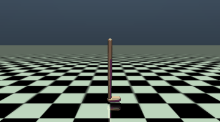
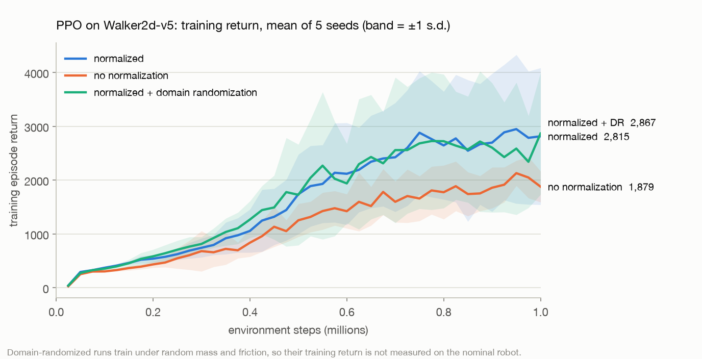
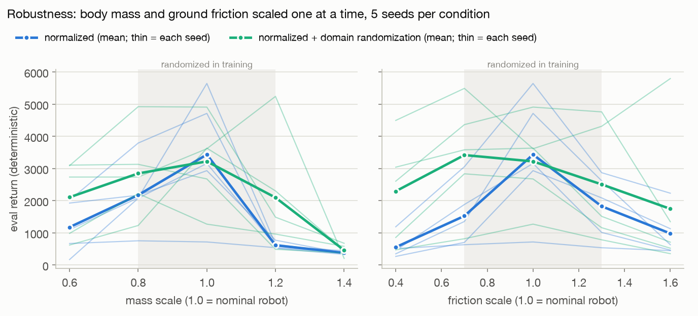

# Walker2d PPO to ONNX

A walking controller for MuJoCo's Walker2d biped. It is trained with PPO, made robust to changes in its own
body with domain randomization, and exported as one ONNX file that takes the raw 17-number state and returns
6 joint torques. Rollouts from the PPO policies then train **behaviour cloning and TD3+BC offline**, in plain
PyTorch ([`offline/`](offline/)).

<p align="center"></p>
<p align="center"><sub>The exported ONNX controller (not the PyTorch policy) on the first held-out episode, real time.</sub></p>

| | |
|---|---|
| **Training** | PPO, 3 conditions × 5 seeds × 1M steps = 15 runs in 30.5 min on an M2 MacBook Air (161 CPU-minutes) |
| **Seeds** | Normalized runs score from 716 to 5,629 on the same task. Five seeds cannot separate normalization from no normalization |
| **Robustness** | With mass or friction changed, domain randomization keeps **1.9×** the return of normal training (2,187 vs 1,156) and finishes **24% vs 3%** of episodes, for 6% less on the nominal robot |
| **Export** | One self-contained 35 KB ONNX file with the normalizer inside. Matches Stable-Baselines3 to **1.6e-6** on 5,802 states and falls on exactly the same episodes |
| **Latency** | **6.9 µs** per step (p50) on one CPU thread: 9.6× faster than SB3 `predict()`, under 0.1% of the 8 ms control period |
| **INT8** | Not worth it here: 2.2× smaller (16 KB), but slower (9.2 µs), and it changes the outcome of 6 of 20 episodes |
| **Offline RL** | From logged rollouts alone, TD3+BC beats behaviour cloning by **17%** on medium data and **47%** on mixed data, where BC falls below the data it copies ([`offline/`](offline/)) |

## The task

Gymnasium `Walker2d-v5` on MuJoCo 3.17: a planar biped (torso, and two legs of thigh, shin and foot).

- **State:** 17 numbers (joint angles and velocities).
- **Action:** 6 torques in [-1, 1], at 125 Hz (8 ms per step).
- **Reward per step:** forward velocity + 1 for staying up - 0.001 × Σtorque².
- **Episode:** 1,000 steps, ending early if the torso drops below 0.8 m or tilts more than 1 rad.

## What was done

1. **Train.** Stable-Baselines3 2.9 PPO on PyTorch 2.14, with the PPO paper's MuJoCo settings (Schulman et al.
   2017): horizon 2048, Adam 3e-4, 10 epochs, minibatch 64, γ 0.99, GAE λ 0.95, clip 0.2, and separate 64-64
   tanh policy and value networks. Three conditions, five seeds each, 1M steps per run:
   - `norm`: running normalization of observations and rewards (`VecNormalize`).
   - `raw`: the same without normalization (ablation).
   - `dr`: `norm` plus domain randomization. At every reset, all body masses and inertias are scaled by one
     factor drawn from U(0.8, 1.2), and all friction coefficients by one drawn from U(0.7, 1.3).
2. **Evaluate** the deterministic policy (the Gaussian's mean) on 20 episodes per run, reset with seeds
   (10000+) that training never uses.
3. **Stress-test** each `norm` and `dr` run. Mass is scaled 0.6-1.4× and friction 0.4-1.6×, one at a time,
   inside and outside the randomized range, with 10 episodes per setting.
4. **Select** the policy to deploy on 20 *validation* episodes (seeds 20000+), each with mass and friction
   drawn from the randomization ranges. The evaluation episodes play no part in the choice. Winner: `dr`
   seed 2.
5. **Export** it to ONNX with the normalizer folded into the graph. Then check it against Stable-Baselines3
   open-loop and closed-loop, benchmark latency, and try INT8 dynamic quantization.

## Results

### 1. Learning: the seed matters more than the ablation can show

<picture>
  <source media="(prefers-color-scheme: dark)" srcset="results/learning_curves_dark.png">
  
</picture>

| Condition | Eval return, mean ± s.d. over seeds | Per seed (0-4) | Falls in 100 episodes |
|---|---|---|---|
| normalized | 3,416 ± 1,890 | 5,629 · 716 · 2,831 · 4,722 · 3,181 | 40 |
| no normalization | 2,253 ± 1,466 | 3,520 · 2,409 · 3,762 · 1,228 · 344 | 54 |
| normalized + DR (nominal robot) | 3,344 ± 1,380 | 2,880 · 4,915 · 4,165 · 1,285 · 3,476 | 51 |

Normalization lifts the mean by 1,163, and the training curves pull apart from about 0.4M steps. But the
seed-to-seed spread is larger than the gap, so with five seeds the effect is suggestive, not established. The
same algorithm and settings produced a policy that runs 37 m per episode and never falls (normalized seed 0)
and one that falls in every episode (seed 1).

### 2. Robustness: domain randomization trades a little peak for a lot of tolerance

<picture>
  <source media="(prefers-color-scheme: dark)" srcset="results/robustness_dark.png">
  
</picture>

| Averaged over 5 seeds | normalized | + domain randomization |
|---|---|---|
| Return, nominal robot | 3,436 | 3,224 (-6%) |
| Return, mean of the 8 changed settings | 1,156 | **2,187** (1.9×) |
| Changed-setting episodes finished without falling | 3% | **24%** |
| Return, validation episodes with random mass and friction | 1,801 | **2,745** |
| Validation episodes finished | 15% | **33%** |

The nominal and changed-setting rows use the sweep's 10 episodes per setting, like the plot. On the 20 evaluation
episodes in section 1, the nominal gap is 2% (3,416 vs 3,344).

- The best policy on the nominal robot (normalized seed 0: 5,629, never falls) finishes 1 of 20
  randomized-physics episodes. The deployed DR seed finishes 16 of 20.
- The gain is uneven across seeds (the thin lines). DR seed 2 finishes every episode at 1.2× mass and 9 of 10
  at both 0.4× and 1.6× friction, while other DR seeds fall.
- Nothing survives 1.4× mass, outside the randomized range.

### 3. Deployment: one ONNX file, raw state in, torques out

A trained policy is two artifacts: the network, and VecNormalize's running statistics. Ship the network without
the statistics and it produces wrong actions without any error. So the export folds both into one graph:

```
obs [batch × 17, float32] → Sub → Div → Clip(±10) → Gemm → Tanh → Gemm → Tanh → Gemm → Max/Min(±1) → action [batch × 6]
```

That's 10 nodes, opset 20, 35.3 KB with the weights inside (no external data file), and a dynamic batch size.

| Check | Result |
|---|---|
| Open loop: 5,802 states (3,246 from walking, 556 from a 1.4× heavy robot, 2,000 synthetic extremes past the clip) | max \|ONNX - SB3\| = **1.6e-6** |
| Closed loop: the 20 held-out episodes | SB3 4,165, ONNX 4,154. The same 6 episodes fall; largest per-episode gap 77 (1.3%) |

Latency, one observation per call (how a control loop calls it), numpy in and out, one CPU thread on an M2:

| Path | p50 | p99 |
|---|---|---|
| SB3 `predict()` | 66.5 µs | 89.0 µs |
| PyTorch module | 24.3 µs | 35.2 µs |
| **ONNX Runtime FP32** | **6.9 µs** | **9.6 µs** |
| ONNX Runtime INT8 | 9.2 µs | 12.9 µs |

INT8 dynamic quantization stores int8 weights and quantizes activations on each call.
- **Accuracy:** it moves actions by up to 0.11 and keeps the closed-loop average (4,181, 6 falls). But a
  different 6 episodes fall, so 6 of 20 episodes change outcome.
- **Speed and size:** on a 64-64 MLP the quantize and dequantize steps cost more than int8 matrix multiplies
  save, so INT8 is slower. The file is 2.2× smaller (16.0 vs 35.3 KB), which buys nothing at this size.

So FP32 ships. Quantization pays off on large perception models, not on a controller this small. If it is ever
applied, the closed-loop outcome-flip rate is the number to watch, not the action error.

### Known failure mode

On the nominal robot, the deployed policy either finishes an episode (about 5,800 return, 39 m) or falls at
step 119-122, about one second in. That happened in 6 of 20 held-out episodes. It is a start-up instability,
not a mid-gait one, which points to the fix: randomize or curriculum the initial states, or reward the
transition from standing.

## Next steps

- Fix the start-up failure, then rerun the seed and robustness comparison with more seeds.
- Compare SAC and TD3 on the same protocol.
- Move to `Humanoid-v5`.
- Randomize sensor noise and action latency as well as mass and friction.
- Build a TensorRT engine from this ONNX file on a Jetson.

## Reproduce

```bash
python3.12 -m venv .venv && .venv/bin/pip install -r requirements.txt
./reproduce.sh                  # everything: about 35 min for PPO, plus a few hours for the 30 offline runs
.venv/bin/python -m pytest -q   # 12 tests: the ONNX file is the trained policy; offline data is labelled right
```

Every number in this README comes from `results/` (CSV and JSON), which `reproduce.sh` regenerates. Seeds never
overlap: training seeds 0-4, evaluation resets 10000+, validation resets 20000+.

## Repo map

| File | Role |
|---|---|
| `config.py` | Every setting in one place |
| `train.py`, `run_sweep.sh` | One run (PPO + VecNormalize, optionally domain randomization); all 15, six at a time |
| `physics.py` | Mass and friction rescaling: `DomainRandomization` for training, `FixedPhysics` for the sweep |
| `evaluate.py` | Held-out evaluation, robustness sweep, validation scores |
| `controller.py` | The controller three ways: SB3 reference, PyTorch module, ONNX Runtime |
| `export_onnx.py` | Selection, export, open-loop parity, INT8 |
| `benchmark.py` | Closed-loop comparison and latency |
| `plot.py`, `render.py` | Figures (light and dark renders), GIF |
| `offline/` | Datasets from the PPO policies, BC and TD3+BC in plain PyTorch, results summary ([README](offline/README.md)) |
| `tests/` | The ONNX file matches SB3, stays in bounds, takes any batch size; offline data marks only falls as terminal |
| `models/` | `walker2d_ppo.onnx` (ships), `walker2d_ppo_int8.onnx`, and the source policy and normalizer |
| `results/` | Every number above |

## Design notes

- **The normalizer lives in the graph.** It is versioned with the weights, so the deployed file cannot drift
  from the statistics it was trained with.
- **One file, really.** torch 2.14's exporter writes the weights to a sidecar `.data` file by default, so the
  `.onnx` alone would not run. The export passes `external_data=False`, and `results/export.json` lists any
  sidecar files (none).
- **The thin lines in the robustness plot are deliberate.** Outcomes are bimodal (finish or fall early), so a
  ±1 s.d. band would dip below zero and hide that.
- **Evaluation is deterministic** (the action distribution's mean). Training curves come from the stochastic
  policy, so they sit below the evaluation numbers.
- **One CPU thread per run**, six runs at a time: all 15 runs finished in 30.5 minutes on an 8-core laptop.
