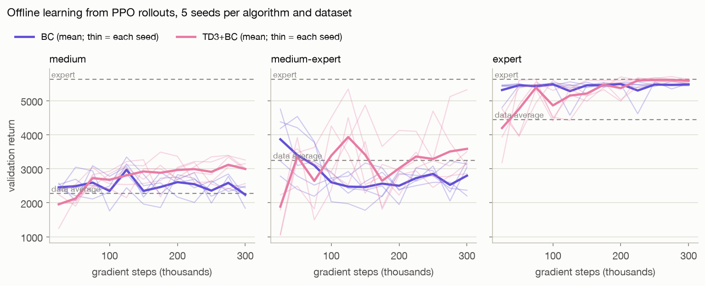

# Offline RL and imitation learning from the PPO rollouts

Can a walking policy be learned from logged data alone, with no environment interaction? This folder trains
**behaviour cloning (BC)** and **TD3+BC** (Fujimoto & Gu 2021) on rollouts from the PPO policies in this repo,
written directly in PyTorch. Stable-Baselines3 is used only to run the PPO policies that generate the data.

<picture>
  <source media="(prefers-color-scheme: dark)" srcset="../results/offline_curves_dark.png">
  
</picture>

## Results

5 seeds per cell, 300k gradient steps each. Every final policy is scored on the same 20 held-out episodes as
the PPO policies (reset seeds 10000+). The validation curve above never picks a checkpoint.

| Dataset | Data average | BC | TD3+BC | TD3+BC over BC |
|---|---|---|---|---|
| medium | 2,267 | 2,520 ± 151 | **2,956 ± 167** | +17%; every TD3+BC seed beats every BC seed |
| medium-expert | 3,246 | 2,693 ± 60 | **3,949 ± 1,050** | +47%; 4 of 5 seeds beat the best BC seed |
| expert | 4,446 | 5,556 ± 16 | 5,644 ± 40 | both reach the expert (5,629) |

Return is the mean over seeds, ± the standard deviation across seeds. Normalized scores, falls and per-seed
values are in [`results/offline_summary.json`](../results/offline_summary.json). The scores follow D4RL's
convention: 100 × (return - random) / (expert - random), with a random policy scoring 1.9 and the
deterministic expert 5,629.

**What it shows**

- **On medium data, TD3+BC improves on the data and on BC.** The critic lets it pick the better actions in the
  data instead of copying all of them. It also falls less (38 vs 54 of 100 episodes).
- **On mixed data, BC does worse than the data it copies** (2,693 vs a 3,246 average). The medium and expert
  policies walk differently, and averaging two gaits gives one that matches neither. TD3+BC's Q-values steer
  it toward the expert's actions, so it reaches 3,949.
- **The gain on mixed data comes with risk.** TD3+BC's seeds range from 2,549 to 5,177, and it falls more
  often than BC (63 vs 51 of 100). One seed falls in 1 of 20 episodes; two fall in all 20 but cover 16-21 m
  before they do.
- **On expert data, both beat the data average.** The data was collected with sampled actions; the trained
  policies act on the mean, which removes the sampling noise. Both reach the expert's level; TD3+BC is 1.6%
  higher, with every seed above every BC seed.

## Data

D4RL-style, 200,000 transitions per source, actions sampled from each PPO policy's own Gaussian.

| Dataset | Source policy | Episodes | Mean episode return | Episodes that fell |
|---|---|---|---|---|
| expert | `norm_s0` (best on the nominal robot: 5,629, never falls when acting deterministically) | 239 | 4,446 | 95 |
| medium | `raw_s1` (the trained policy closest to 40% of the expert) | 293 | 2,267 | 225 |
| medium-expert | both | 532 | 3,246 | 320 |

Only falls are marked terminal. An episode cut off at the 1,000-step limit keeps bootstrapping in the TD
target; otherwise the critic would learn that walking well leads to zero future reward. `tests/test_offline.py`
checks this.

## Implementation

`train.py` and `common.py`, about 230 lines of PyTorch:

- **Networks:** an actor (256-256 ReLU, tanh output) and twin critics. States are normalized with the
  dataset's mean and standard deviation.
- **BC:** mean-squared error to the dataset's actions.
- **TD3+BC:** TD3 with clipped double-Q targets, target-policy smoothing (noise 0.2, clipped at 0.5), delayed
  actor and target updates (every 2 steps, τ = 0.005) and γ = 0.99. The actor loss is
  -λ·Q(s, π(s)) + (π(s) - a)², with λ = 2.5 / mean|Q|.
- **Shared settings:** Adam 3e-4, batch 256 and 300k steps for both, so the critic is the only difference.

## Reproduce

From the repo root:

```bash
.venv/bin/python -m offline.collect     # datasets -> offline/data/ (about 1 min)
./offline/run_all.sh                    # 30 runs, 6 at a time
.venv/bin/python -m offline.summarize   # results/offline_*, figure
```

On an M2 MacBook Air with other apps open, six at a time, a TD3+BC run took about an hour (median 63 min) and a
BC run about 6 minutes. The 15 TD3+BC runs are almost all of the cost.
